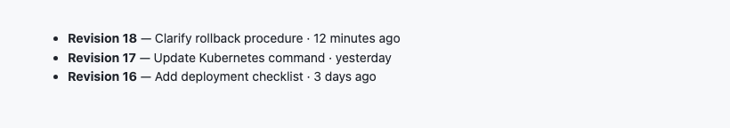

<!-- Generated by kumbuka-me/plugins scripts/docs. Edit the plugin README, manifest or preview in that repository. -->

# Revision History

Show the latest revision and open a color-coded comparison dialog.

- Plugin ID: `me.kumbuka.revision-history`
- Source version: `1.2.1`
- Permissions: `pages:read`

[Source](https://github.com/kumbuka-me/plugins/tree/main/revision-history) · [Releases](https://github.com/kumbuka-me/plugins/releases?q=revision-history%2Fv) · [Installation](../administration/plugins.md)

Revision History adds a **Latest revision** summary to page details and contributes a **View changes** action and a page action that open Kumbuka's full revision-history fragment in a dialog.

Kumbuka core continues to own revision persistence, metadata snapshots, restore authorization, diffs, and the full history endpoint. Older revisions without snapshots remain Markdown-only. The plugin owns the optional page-details presentation.

## Permissions

- `pages:read` reads authorized public revision metadata for the current page.
